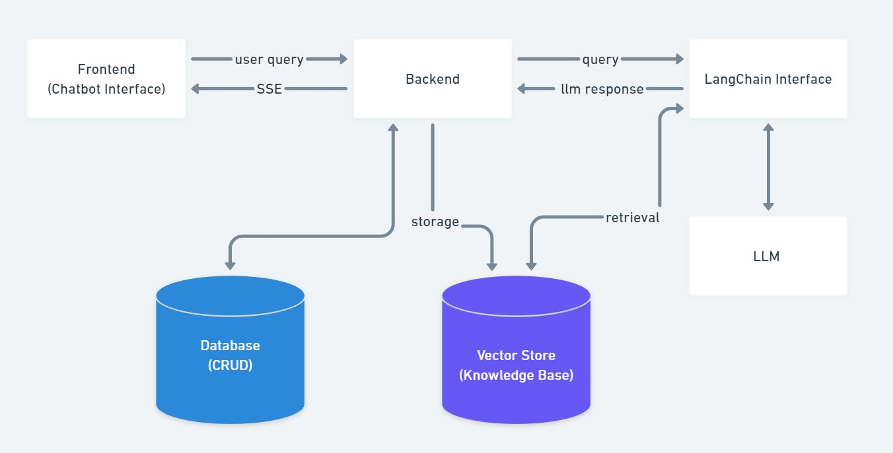
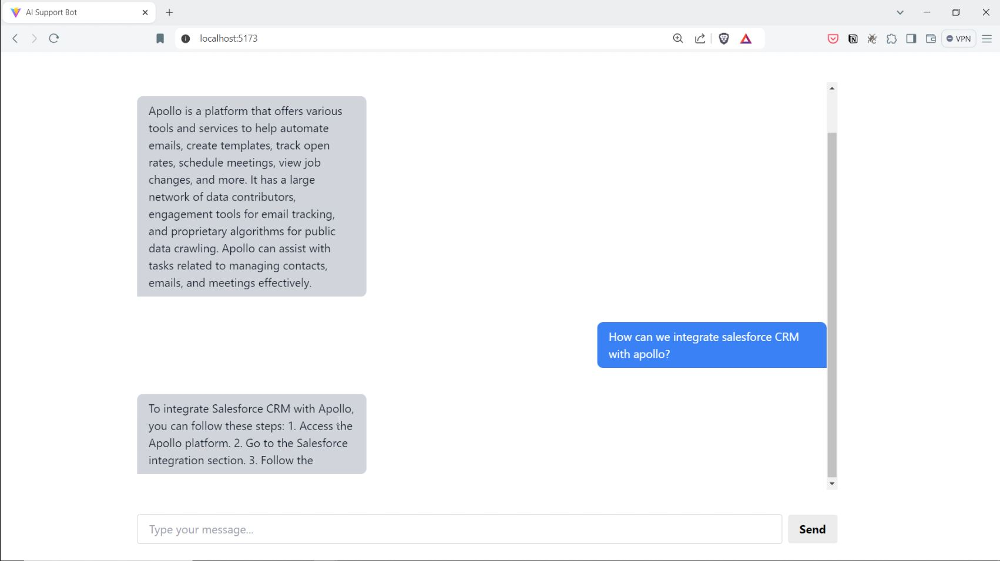

# AI Support Bot with Custom Knowledgebase Integration

[](https://github.com/ysskrishna/ai-support-bot/blob/main/LICENSE) [](https://ysskrishna.space)

A full-stack chatbot application that uses RAGS to interact intelligently with users based on custom-loaded knowledgebases. It supports dynamic dataset loading for seamless updates. The chatbot’s language model is evaluated on relevance, accuracy, coherence, completeness, creativity, tone, and alignment with intent, ensuring high-quality, user-focused interactions.

## Techstack used
- React
- Tailwindcss
- FastAPI
- ChromaDB
- Langchain
- OpenAI
- Docker


## Flowchart
This diagram illustrates the high level components involved and thier interaction


## Demo


<video width="320" height="240" controls>
  <source src="./media/ai_support_bot_demo.mp4" type="video/mp4">
</video>


https://github.com/user-attachments/assets/49a82013-c936-4f13-8739-646039b77d55


## Project Configuration
Before running the project, make sure to adjust the following configuration files:

### Backend Configuration
- Adjust the `.env` file located in the backend folder if any environment variables need modification.


## Start Containers
To start the project, use Docker Compose to build and run the containers:
```
docker compose up --build
```

### Frontend URL
Once the containers are running, you can access the frontend application at:
```
http://localhost:5173/
```

### Backend URL
Once the containers are running, you can access the backend application at:
```
http://localhost:8081/
```

## Pending Improvements
- Add SQL/NoSQL DB to store the user queries and generated reponses

https://github.com/pixegami/langchain-rag-tutorial

## Built and maintained by

AI Support Bot with Custom Knowledgebase Integration is built and maintained by:

| | Name | GitHub | Role |
|---|------|--------|------|
|  | **Y. Siva Sai Krishna** | [@ysskrishna](https://github.com/ysskrishna) | Creator |

## Support

If you find this project helpful:

- ⭐ Star the repository
- 🐛 [Report issues](https://github.com/ysskrishna/ai-support-bot/issues)
- 🔀 Submit pull requests
- 💝 [Sponsor on GitHub](https://github.com/sponsors/ysskrishna)

## License

AGPL-3.0 © [Y. Siva Sai Krishna](https://github.com/ysskrishna) — see [LICENSE](LICENSE) for details.

---

<p align="left">
  <a href="https://github.com/ysskrishna">Author's GitHub</a> •
  <a href="https://linkedin.com/in/ysskrishna">Author's LinkedIn</a> •
  <a href="https://ysskrishna.space">Author's site</a> •
  <a href="https://github.com/ysskrishna/ai-support-bot/issues">Report Issues</a>
</p>
